# Serambi.ai

An adaptive multi-agent learning assistant for Indonesian career switchers.

Serambi.ai takes a career goal ("become a data analyst in 3 months") and produces a weekly roadmap, then walks the learner through it: concepts explained Feynman-style, adaptive quizzes with graduated hints, spaced-repetition review, and check-ins that watch for burnout. The conversational interface runs in Bahasa Indonesia.

[What it does](#what-it-does) · [Why it exists](#problem-statement-and-market-gap) · [How it works](#how-it-works) · [Architecture](#architecture) · [Agents](#agents) · [Install](#install) · [Usage](#usage) · [Business model](#business-model) · [Guardrails](#guardrails) · [Roadmap](#roadmap) · [Repository structure](#repository-structure) · [MCP integration](#mcp-integration) · [AI agent skills](#ai-agent-skills) · [Development tools](#development-tools) · [Maintainers](#maintainers) · [License](#license)

> The Indonesian version lives in [`README.id.md`](README.id.md).

**IBM SkillsBuild University Education National Hackathon** · Hacktiv8 × IBM × Komdigi

[](LICENSE)

> *Serambi* (Indonesian): a veranda or front porch. A place where conversation starts.

## What it does

One flow is live end to end today: `goal_decomposer`. A learner states a career goal in natural language and receives a structured weekly roadmap in Indonesian, with milestones and a first concrete action.

```
$ Bantu saya buat roadmap belajar data analyst dalam 3 bulan
→ {
    "goal": "Data analyst",
    "deadline_weeks": 12,
    "milestones": [ ... ],
    "first_action": "..."
  }
```

Verification:

```bash
bash scripts/verify-flow.sh    # exit 0: flow structure valid
bash scripts/verify-e2e.sh     # exit 0 when a Langflow server is running; exit 2 when it is not
```

**Research grounding.** Design decisions follow published work rather than intuition:

| Decision | Source |
|---|---|
| Goal-to-skill mapping | GenMentor, 2025. [DOI 10.1145/3701716.3715244](https://doi.org/10.1145/3701716.3715244) |
| Feynman technique, learning gains over passive reading | Feynman Bot, IEEE TALE 2024. [arXiv 2506.09055](https://arxiv.org/abs/2506.09055) |
| Spaced repetition from a forgetting-curve model | Zaidi et al., AIED 2020. [arXiv 2004.11327](https://arxiv.org/abs/2004.11327) |
| Guide instead of answering (anti-offloading) | Fan et al., British Journal of Educational Technology 56(2), 2024. [DOI 10.1111/bjet.13544](https://doi.org/10.1111/bjet.13544), cited 700+ |
| Multi-agent architecture: one learner model, specialized agents | IntelliCode (multi-agent tutoring) |

The same reasoning is written out at length in [`research/`](research/).

## Problem statement and market gap

Indonesia's career switchers are adults with a job who need a new skill set: an admin officer moving into data analysis, a teacher moving into backend work. They study at night, on a limited budget, in Bahasa Indonesia, and they cannot answer "what should I learn this week" from a course catalog.

Three gaps, in order of how much they cost the learner:

1. **Learning platforms start from a curriculum, not from a goal.** Dicoding, Ruangguru, and Zenius all organize by subject. None of them takes "I want to become a data analyst in 6 months" and returns a week-by-week plan.
2. **General AI tutors are oracles, and that is the problem.** ChatGPT answers. BJET's metacognitive-laziness finding ([DOI 10.1111/bjet.13544](https://doi.org/10.1111/bjet.13544), cited 700+) shows the cost: when the model does the thinking, the learner keeps less.
3. **The upskilling market is growing and almost entirely corporate.** Global figures run 11–14% CAGR, concentrated in B2B and corporate programs. The individual adult learner who is switching careers is left between the two.

Full competitive analysis with 11 competitors: [`docs/business/competitive-analysis.md`](docs/business/competitive-analysis.md).

### The Indonesian market opportunity

The talent gap is what makes this market worth entering. Indonesia sits near the top of the world for AI *use* and near the bottom for AI *development*. The Communications and Digital Ministry projects 9 million digital professionals needed by 2030 with about a third of that met, and the Deputy Minister for Communication and Digital Affairs has named the AI talent gap as one of the most critical constraints. Talent working in AI grew from roughly 28,000 in 2019 to 96,000 in 2024 (Kompas), while the National AI Roadmap white paper targets 100,000 AI talents per year.

Demand is not the obstacle. AWS research published in August 2025 records AI adoption by Indonesian businesses up 47% year on year to 28% of businesses (18 million), with 57% naming the lack of digital skills as the main barrier to expanding use. The constraint is supply of the skill, which places Serambi.ai on the supply side of a problem the market already agrees exists.

**Standards alignment.** The work maps to two Sustainable Development Goals, which Indonesia reviewed in its 2025 Voluntary National Review: SDG target 4.3 (affordable technical and vocational education, including non-formal learning) and 4.4 (relevant technical skills for employment), plus SDG 8.2 and 8.6. The mapping, the evidence behind it, and the figures deliberately not claimed are in [`docs/business/sdg-alignment.md`](docs/business/sdg-alignment.md).

## How it works

Six agents, each an independent Langflow flow exposed as a named MCP tool.



The loop is the product. A learner who drops out at week 4 never reaches the milestone, so the Progress, Motivator, and Wellbeing agents carry as much weight as the Tutor.

## Capability

Seven capabilities carried this project from a vague idea to a working system, each with a traceable artifact:

| Capability | What it did | Where to look |
| --- | --- | --- |
| Analytical | Ranked 11 competitors by threat, pulled Astra AI's real App Store prices (Rp 115.000/month Plus, Rp 385.000/month Sigma) into a price anchor, and placed Serambi.ai on a positioning map | [`docs/business/competitive-analysis.md`](docs/business/competitive-analysis.md) |
| Critical | Caught and corrected three unverifiable research claims (\"80%+ prefer Feynman\", \"15-20% retention\", BJET \"cited 694\") and fixed the deck and docs so every claim now carries a DOI or arXiv ID | [`README.md`](#what-it-does) research table, `git log` |
| Systematic | Ran a research, audit, execution sequence; kept every decision as an ADR; enforced feedback-loop verification scripts with explicit exit codes before every commit | [`docs/adr/`](docs/adr/), [`scripts/verify-flow.sh`](scripts/verify-flow.sh) |
| Creative | Built the \"veranda\" metaphor into the brand and the positioning line \"the only one that starts from your goal\" | [Brand assets](assets/), positioning map in competitive analysis |
| Innovative | Combined a scaffold-not-oracle pedagogy with spaced repetition and burnout detection, drawn from separate literature | [`research/`](research/), Guardrails below |
| Problem solving | Started from the metacognitive-laziness problem rather than the chatbot trend: the answer is a guide, not an oracle | [Problem statement](#problem-statement-and-market-gap), BJET DOI above |
| Technical | Shipped a working Langflow flow exposed as an MCP tool, verified by script, independent of any single LLM provider | [Architecture](#architecture), [`.bob/mcp.json`](.bob/mcp.json) |

## Architecture

One MCP contract, two harnesses. IBM Bob is the development harness where each agent is built and verified end to end. The web app is the production interface, and it calls the same named MCP tools.



| Component | Role |
| --- | --- |
| IBM Bob | Development harness. Reasoning, tool-calling, agent verification. Not the end-user UI |
| Web app (`apps/web`) | Production user interface, in development. Calls the same MCP tools |
| MCP | Bridge over streamable HTTP. Any caller resolves Langflow flows to named tools |
| IBM Langflow | Flow execution engine. Each flow is one specialized agent |
| LLM provider | OpenAI-compatible endpoint, temperature 0.3, so structured output stays stable |

## Agents

| Agent | Tool Name | Status |
| --- | --- | --- |
| Goal Agent | `goal_decomposer` | Live, e2e verified |
| Tutor Agent | `explain_concept` | Planned |
| Assessment Agent | `generate_quiz` | Planned |
| Progress Agent | `check_progress` | Planned |
| Motivator Agent | `send_reminder` | Planned |
| Wellbeing Agent | `check_wellbeing` | Planned |

Agent 1 is the tracer bullet and is proven end to end. Agents 2 through 6 are stretch goals for the current phase.

**Stage 2, after the six agents:** a retrieval layer over the project's own research corpus (`research/`), so the Tutor and Assessment agents ground explanations, hints, and questions in the cited evidence rather than in model recall. Scope and rationale in [`docs/PRD.md`](docs/PRD.md); tracked as ISS-12.

## Install

### Prerequisites

| Requirement | Version |
|---|---|
| IBM Bob | v2.0+ |
| Langflow | v1.12+ (Docker recommended) |
| Node.js | v20+ |
| Python | 3.11+ |
| `uvx` | `pip install uv` |

### 1. Clone and configure

```bash
git clone https://github.com/mmuchsin/serambi-ai.git
cd serambi-ai
cp .env.example .env
# edit .env: set LANGFLOW_API_KEY
```

### 2. Start Langflow

```bash
docker run -p 7860:7860 langflowai/langflow:1.12.2
```

Open http://localhost:7860, import `flows/goal_decomposer.json`, and set its Endpoint Name to `goal_decomposer`.

### 3. Load the API key

```bash
source ~/.bashrc   # or: export LANGFLOW_API_KEY=<your-key>
```

### 4. Open Bob in this workspace

Bob loads `.bob/mcp.json` on start. The `lf-serambi_ai` server connects to Langflow over streamable HTTP, and every Langflow flow with an Endpoint Name surfaces as a named tool. No further setup.

## Usage

In Bob:

```
Bantu saya buat roadmap belajar data analyst dalam 3 bulan
```

Bob calls `goal_decomposer`, Langflow runs the flow, and the response is a structured 12-week roadmap: deadline in weeks, milestones with focus and deliverable, and a first action.

To verify without a live server:

```bash
bash scripts/verify-flow.sh
```

Exit codes: 0 means the flow structure is valid. Exit 2 from `verify-e2e.sh` means no Langflow server is reachable, not that the flow is broken.

Configuration reference: [`mcp/README.md`](mcp/README.md).

## Business model

The project is filed under Education and Future of Work. It has to work as a business, not only as a demo, and the cost shape of an LLM product is what decides that.

### Why AI unit economics need a decision up front

Published figures put AI product gross margin near 45% in 2025, rising toward the low 50s in 2026, against 60–80% for traditional SaaS ([1752vc + ICONIQ, State of AI 2026](https://www.iconiqcapital.com/insights/2026-state-of-ai)). Inference cost scales with usage, so margin has to be managed per user rather than assumed. Serambi.ai's cost per user is one decomposition per goal, plus review and quiz calls, so the roadmap is short (one prompt cycle) while the loop is long. Plan for usage-based or hybrid pricing from the start, and keep the North Star metric on learning progress rather than revenue, since revenue lags several months behind.

### Willingness to pay

The nearest consumer anchor is Astra AI at Rp 115.000 per month ([App Store ID](https://apps.apple.com/id/app/id6751030141)) for school-exam preparation. Career switching carries a higher willingness to pay than exam prep: the buyer is paying for an outcome, a job, rather than a grade. Serambi.ai avoids matching that price point and instead sells the outcome.

### Revenue paths, ranked by time to first revenue

| Path | Who pays | Market size | Notes |
|---|---|---|---|
| B2B white-label | Bootcamps, campuses, Komdigi reskilling programs | Thousands of learners per institution, low cost per learner | Fastest to revenue. The flow already runs behind an MCP endpoint |
| Institutional licensing | Vocational schools and universities | Recurring, per-cohort | Requires multi-tenant work on Langflow |
| Consumer subscription | Individual career switchers | Largest, most competitive | Astra AI already holds this price band |

Anonymized forgetting-curve data across learners becomes a defensible asset: the aggregate review schedule is the moat, while the source material stays out of the product.

Business documents: [`docs/business/north-star.md`](docs/business/north-star.md) · [`docs/business/value-proposition.md`](docs/business/value-proposition.md) · [`docs/business/competitive-analysis.md`](docs/business/competitive-analysis.md)

## Guardrails

Two kinds apply: pedagogical and operational.

**Pedagogical, from research:**

| Constraint | Effect |
|---|---|
| Scaffold, not oracle | The agent guides instead of answering. A learner who is stuck gets the smallest useful hint, not the solution |
| Graduated hinting | Hints escalate only when the smaller one fails |
| Probing questions | "Why" and "how" surface a gap sooner than an explanation does |
| No cognitive offloading | The agent refuses to do the learner's thinking for them |
| Goal-first | Every response points back to the stated career goal |

**Operational:**

- Each flow is separately verifiable, and `verify-flow.sh` runs before every commit.
- Structured output with `temperature = 0.3` keeps decomposition deterministic enough for downstream agents to rely on.
- Node configurations follow the NIST AI Risk Management Framework functions (govern, map, measure, manage) at a level appropriate to a prototype.
- Indonesian regulatory context is tracked in [`docs/`](docs/): the Kominfo Circular on AI Ethics (2023) and the Komdigi National AI Roadmap public consultation (August 2025). Serambi.ai targets Indonesia first.
- The research corpus used for grounding is project material. No learner data and no paid content enter the retrieval set.

## Roadmap

### Delivered

- `goal_decomposer` flow, verified end to end through Bob, MCP, and Langflow
- Verification scripts with explicit exit codes
- Five ADRs covering the architecture
- Competitive analysis (11 competitors), value proposition, and North Star metric
- Pitch deck, 11 slides, with speaker notes

### Stage 1, remaining

- Agent 2, `explain_concept`: Feynman-style tutoring with probing questions
- Agent 3, `generate_quiz`: adaptive quiz with graduated hints
- Web app UI in [`apps/web`](apps/web) calling the same MCP tools
- Demo video, 2 to 3 minutes

### Stage 2

- Agents 4 through 6: Progress, Motivator, Wellbeing
- Retrieval layer over `research/` for the Tutor and Assessment agents (ISS-12)
- B2B white-label integration with one bootcamp or campus
- Usage tracking against the North Star metric: Career Goal Progress Rate, target 15% per week per active learner

Hackathon calendar (IBM SkillsBuild University Education National Hackathon, Hacktiv8 × IBM × Komdigi):

| Date | Milestone |
|---|---|
| 4 Oct 2026 | Stage 1 submission deadline, extended by the committee to 11 Oct 2026 |
| 13 Oct 2026 | Top 25 semifinal announced |
| 14–31 Oct 2026 | Stage 2 submission |
| 6 Nov 2026 | Top 7 final announced |
| 14 Nov 2026 | Online final and awarding |
| Jan 2027 | IBM Day showcase |

## Repository structure

```
serambi-ai/                          monorepo root
├── .bob/
│   ├── mcp.json                     MCP server config (lf-serambi_ai)
│   ├── settings.json                Turn-counter hook, session discipline
│   └── skills/                      83 agent skills
├── flows/                          Langflow flow exports
├── agents/                         Agent configs and system prompts
├── apps/web/                       Web frontend, target user interface
├── packages/                       Shared libraries
├── docs/
│   ├── PRD.md                      Product requirements, including Stage 2 RAG
│   ├── ISSUES.md                   Issue tracker, ISS-01 to ISS-12
│   ├── business/                   Competitive analysis, north-star, value proposition
│   └── adr/                        Architecture decision records 0001–0005
├── mcp/README.md                   MCP integration details
├── research/                       Papers and abstracts (multi-agent tutoring, feedback loop)
├── scripts/                        verify-flow.sh, verify-e2e.sh
├── slides/                         Pitch deck v2, 11 slides plus speaker notes
├── submission/                     Screenshots for the submission form
└── assets/
    ├── screenshots/                Demo screenshots 01–04
    └── diagrams/                   Architecture diagram, source HTML included
```

## MCP integration

Bob connects to Langflow through mcp-proxy over streamable HTTP. Configuration in [`.bob/mcp.json`](.bob/mcp.json); the API key is read from the environment and never committed. Every Langflow flow with an Endpoint Name becomes a callable tool, so `mcp__lf-serambi_ai__goal_decomposer` resolves to the live flow. Details and troubleshooting: [`mcp/README.md`](mcp/README.md).

## AI agent skills

The project runs inside IBM Bob and uses skills loaded on demand with `$skill-name`.

| Skill | Purpose |
|---|---|
| `diagram-design` | Architecture, flow, journey, and chart diagrams as HTML/SVG |
| `pitch-deck` | 11-slide pitch deck structure (custom skill for this project) |
| `value-proposition` | Jobs-to-be-done template |
| `north-star` | North Star metric and input metrics |
| `competitive-analysis` | Competitor mapping and differentiation |
| `business-model` | Canvas-based business model work |
| `plan-launch` | Go-to-market and beachhead segment |
| `ai-engineering-workflow` | Seven-phase engineering workflow |
| `ai-coding-best-practices` | Deep modules, TDD, feedback loops |

The full set is 83 skills. Sources: [phuryn/pm-skills](https://github.com/phuryn/pm-skills), [mattpocock/skills](https://github.com/mattpocock/skills), and project custom skills, all under [`.bob/skills/`](.bob/skills/).

## Development tools

Bob covers agent orchestration, MCP tool-calling, and flow verification. Two tasks sit outside it:

| Tool | Purpose |
|---|---|
| [pi agent](https://pi.dev/) with the [feynman extension](https://pi.dev/packages/@companion-ai/feynman) | Academic research and paper search |
| Qwen3.8-27B | Research reasoning |
| Qwen-Image-2.1 | Image assets for slides and diagrams |

## Maintainers

**M. Muchsin**, [github.com/mmuchsin](https://github.com/mmuchsin)

## License

Apache 2.0 © 2026 Serambi.ai Contributors. See [LICENSE](LICENSE).
